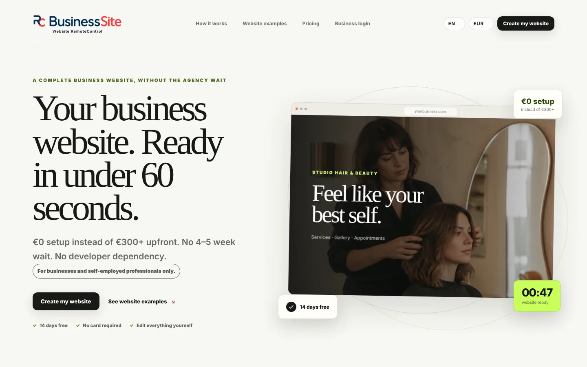
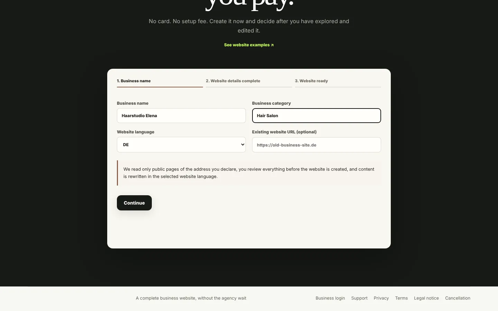
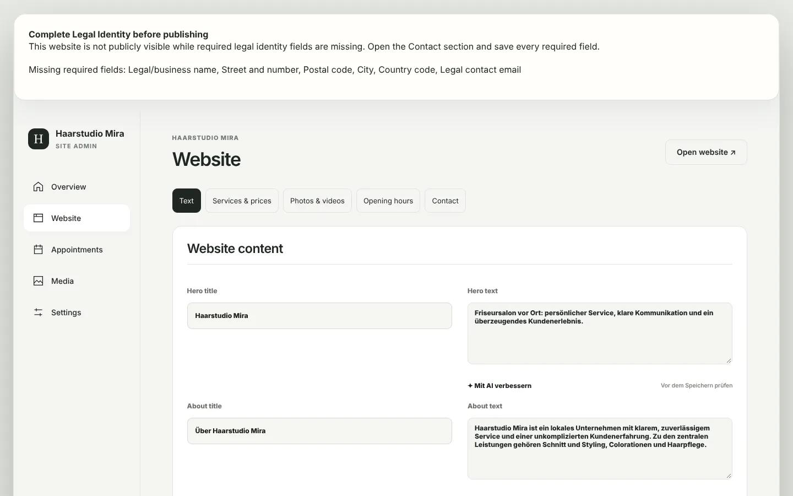
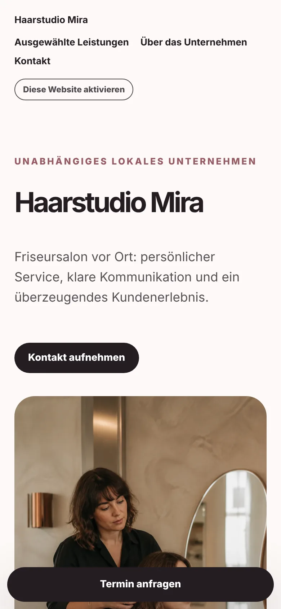
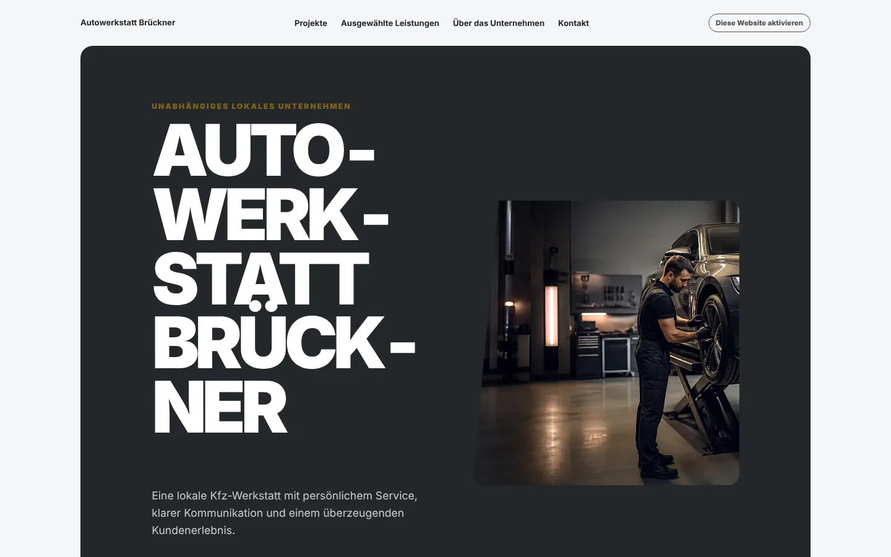

# BusinessSite RC

**Website RemoteControl for small businesses.** A business enters its name and category and gets a finished, multilingual website in under a minute, which it then edits itself: texts, services and prices, photos, opening hours, contact details and appointment requests. No agency lead time, no setup fee, no developer for small changes.

[](https://github.com/IamRedi/businesssite/actions/workflows/ci.yml)

**[Deutsche Version](README.md)** · **As of 27 October 2026** · **[Project status](docs/PROJEKTSTAND.md)** · **[Verification record](EVIDENCE.md)**



## P2 online · 5 November 2026

The native presentation is published and verified in DE/EN/IT/SQ. [Publication receipt](docs/P2_PUBLICATION_20261105.md). Product limits and historical application evidence remain explicit.

## Public legal pages · 5 November 2026

InfoEsencë now has its own [imprint](https://infoesence.com/imprint?lang=en) and [privacy notice](https://infoesence.com/privacy?lang=en) in DE/EN/IT/SQ.172 dedicated local RLS tests, upgrade preservation and48 public Windows WebKit checks PASS. Clouvider remains active; the old unused Vercel installation is paused. Commercial release and physical Safari/product journeys remain separate. [Receipt](docs/P2_PUBLICATION_20261105.md).

## Website and languages · 5 November 2026

The public presentation has dedicated URL editions in [German](https://www.businesssiterc.de/?lang=de), [English](https://www.businesssiterc.de/?lang=en), [Italian](https://www.businesssiterc.de/?lang=it) and [Albanian](https://www.businesssiterc.de/?lang=sq), including language access on phones. Registration, the business dashboard and reviewed legal documents retain their actual DE/EN contract, with an explicit handoff from the introduction.

Published customer sites [InfoEsencë](https://infoesence.com/about?lang=en) and [Mustafa Haziri](https://mhaziri.de/about?lang=en) receive four-language introductions in their existing native brand styles. Articles remain Albanian; detailed salon services and prices remain German. Appointment requests require personal confirmation. The introduction does not translate or modify customer records.

The P2 native presentations were published on the existing domains and anonymously verified on 5 November 2026. Application code and historical test counts in this public snapshot retain their original revisions. Presentation acceptance does not establish commercial, fiscal, legal or device acceptance.

After material product changes, reconcile the native introduction, portfolio card and affected README/About copy in the same delivery cycle. Record a justified `NO_CONTENT_CHANGE` for internal work.

## What exists today

| Status | Scope |
|---|---|
| **Implemented and in production** | Three-step self-service demo, website engine with category templates and themes, business admin (texts, services and prices, photos and videos, opening hours, contact, appointments), private preview links, legal-identity gate before publishing, platform admin with password plus TOTP and fixed roles, custom domains. The platform has run on its own server in Frankfurt since October 2026 and hosts the first own and friendly websites there. |
| **Verified** | 1,371 automated tests passing locally (unit, integration against PostgreSQL 16, enforced row-level security with restricted roles), typecheck, lint, production build, gitleaks with no findings. Details in the [verification record](EVIDENCE.md). |
| **Implemented, not active here** | Stripe checkout with grace and read-only phases, email via Resend, Google Places business discovery, AI import of an existing website and AI text improvement (OpenAI), media storage (Vercel Blob or S3/R2), news CMS for information sites. The code is tested; without keys these features stay off. |
| **Open** | Commercial sale is not released: the legal texts (terms, privacy, DPA) await professional legal review. Safari/WebKit acceptance on real devices is incomplete. See [project status](docs/PROJEKTSTAND.md). |

## A look at the application

All images come from a local production build with fictitious businesses. They are not mockups.

| 1. Enter name and category | 2. Finished website (desktop) |
|---|---|
|  |  |

| 3. Edit it yourself | Mobile | Another category |
|---|---|---|
|  |  |  |

## How it is built

```text
Find or enter a business -> PreparedBusinessProfile -> website engine -> SiteDocument -> renderer
```

- **Next.js 16 / React 19 / TypeScript**, npm workspaces, Node 22.
- **`packages/website-engine`** is a pure function: profile in, website document out. No network, no database, no environment variables, enforced by `npm run check:boundaries`.
- **PostgreSQL** with 91 ordered migrations, separate database roles (runtime, system, owner) and per-tenant row-level security.
- **186 template images**, all generated with AI for this project and listed with SHA-256 in the [asset register](docs/ASSET_AND_LICENSE_AUDIT.md).
- Security model, sessions, MFA and billing rules are in [SECURITY.md](SECURITY.md) and [ARCHITECTURE.md](ARCHITECTURE.md).

## Run it locally

Requirements: Node.js 22, PostgreSQL 15 or newer.

```bash
npm ci
cp .env.example .env.local      # set DATABASE_URL and the three role URLs
npm run setup:secrets
npm run migrate
npm run dev
```

Open `http://localhost:3000` and create a business under "Create my website". `npm run owner:bootstrap` sets up the platform admin. Every step is in [docs/QUICK_START.md](docs/QUICK_START.md).

Checks: `npm run quality` (typecheck, lint, tests, boundaries, doc links, secret scan, audit, build) and `npm run test:rls` against a disposable database.

## About this repository

This is a **public snapshot** of the privately developed repository, taken from `master` on 26 October 2026 (the application code that runs in production plus one small performance change not yet rolled out). Removed: server and database identifiers, production runbooks, internal task and evidence folders, data of real businesses and internal agent instructions. The Git history is intentionally not included.

## License

Source-available: reading and local evaluation are allowed, use and redistribution are not. White-label licenses are available on request. See [LICENSE](LICENSE) and the [licensing model](docs/COMMERCIAL_MODEL.md).

Built by **Redion Cekrezi** ([@IamRedi](https://github.com/IamRedi)).
