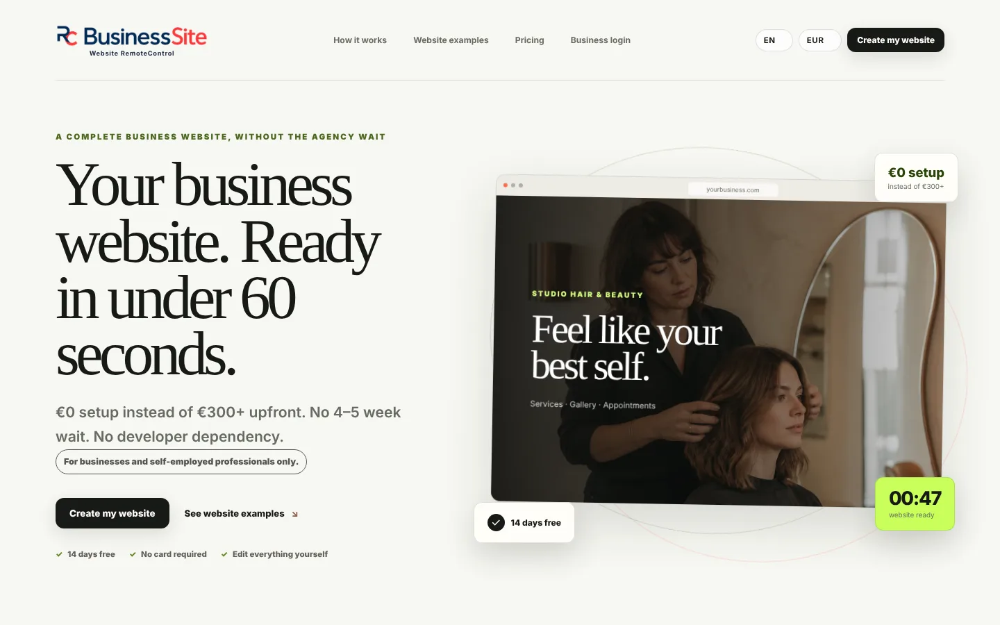
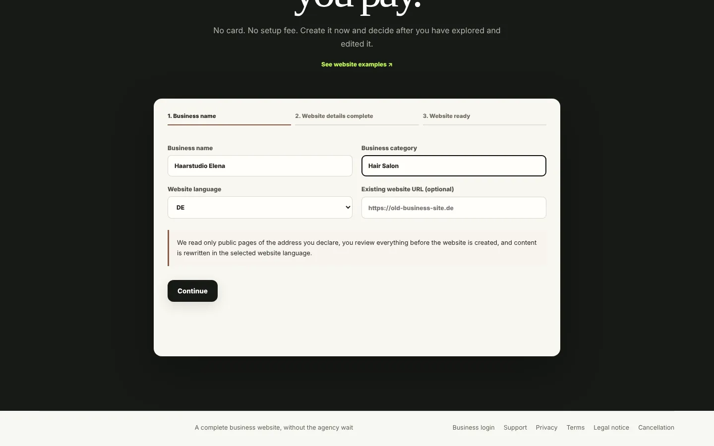
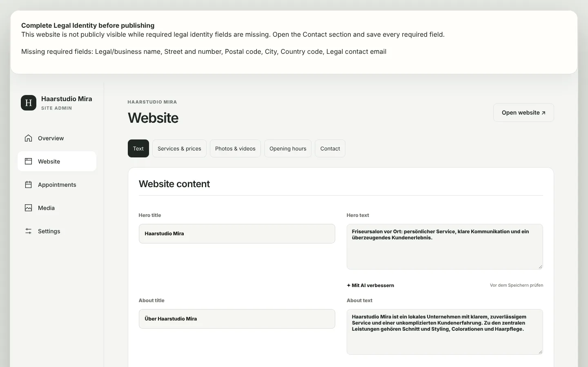
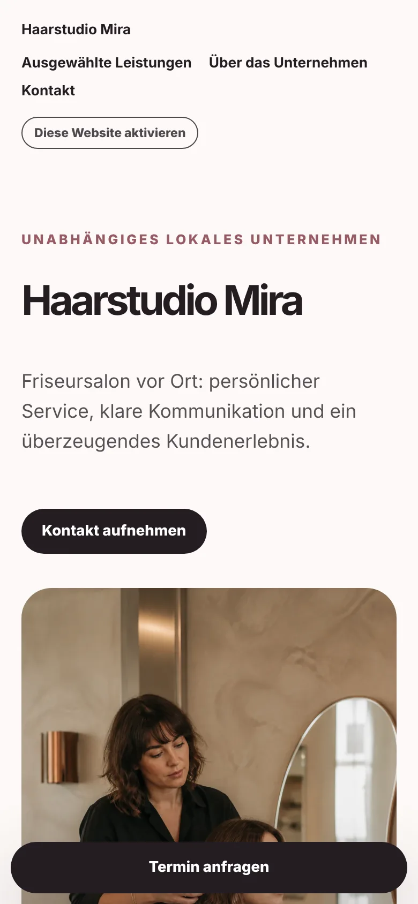
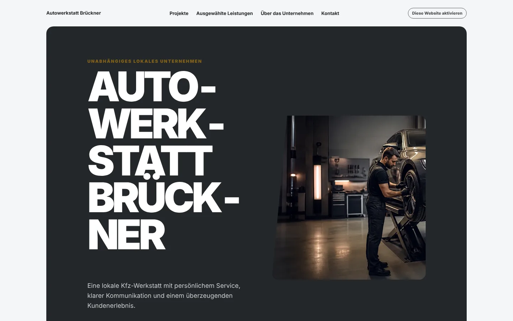

# BusinessSite RC

**Website RemoteControl für kleine Betriebe.** Ein Betrieb gibt Namen und Branche ein und hat in unter einer Minute eine fertige, mehrsprachige Website, die er danach selbst bearbeitet: Texte, Leistungen und Preise, Fotos, Öffnungszeiten, Kontakt und Terminanfragen. Kein Agentur-Vorlauf, keine Einrichtungsgebühr, keine Entwickler für kleine Änderungen.

[](https://github.com/IamRedi/businesssite-rc/actions/workflows/ci.yml)

**[English version](README.en.md)** · **Stand: 27. Oktober 2026** · **[Projektstand](docs/PROJEKTSTAND.md)** · **[Prüfprotokoll](EVIDENCE.md)**



## Was heute umgesetzt ist

| Status | Umfang |
|---|---|
| **Umgesetzt und in Produktion** | Self-Service-Demo in drei Schritten, Website-Engine mit Branchenvorlagen und Themes, Business-Admin (Texte, Leistungen und Preise, Fotos und Videos, Öffnungszeiten, Kontakt, Termine), private Vorschau-Links, Impressumspflicht vor Veröffentlichung, Plattform-Admin mit Passwort plus TOTP und festen Rollen, eigene Domains. Die Plattform läuft seit Oktober 2026 auf einem eigenen Server in Frankfurt und hostet dort die ersten eigenen und befreundeten Websites. |
| **Verifiziert** | 1.368 automatisierte Tests lokal grün (Unit, Integration gegen PostgreSQL 16, durchgesetzte Row-Level Security mit eingeschränkten Rollen), Typecheck, Lint, Produktionsbuild, gitleaks ohne Funde. Details im [Prüfprotokoll](EVIDENCE.md). |
| **Umgesetzt, hier nicht aktiv** | Stripe-Checkout mit Kulanzzeit und Read-only-Phase, E-Mail über Resend, Google-Places-Suche nach Betrieben, KI-Import einer bestehenden Website und KI-Textverbesserung (OpenAI), Medienspeicher (Vercel Blob oder S3/R2), News-CMS für Informationsseiten. Der Code ist getestet; ohne Schlüssel bleiben diese Funktionen aus. |
| **Offen** | Kommerzieller Verkauf ist nicht freigegeben: Die Rechtstexte (AGB, Datenschutz, AVV) warten auf anwaltliche Prüfung. Safari/WebKit-Abnahme auf echten Geräten ist unvollständig. Siehe [Projektstand](docs/PROJEKTSTAND.md). |

## Einblick in die Anwendung

Alle Bilder stammen aus einem lokalen Produktionsbuild mit erfundenen Betrieben. Es sind keine Mockups.

| 1. Name und Branche eingeben | 2. Fertige Website (Desktop) |
|---|---|
|  |  |

| 3. Selbst bearbeiten | Mobil | Andere Branche |
|---|---|---|
|  |  |  |

## Wie es aufgebaut ist

```text
Betrieb finden oder selbst anlegen -> PreparedBusinessProfile -> Website-Engine -> SiteDocument -> Renderer
```

- **Next.js 16 / React 19 / TypeScript**, npm-Workspaces, Node 22.
- **`packages/website-engine`** ist eine reine Funktion: Profil rein, Website-Dokument raus. Kein Netzwerk, keine Datenbank, keine Umgebungsvariablen. Das wird per `npm run check:boundaries` erzwungen.
- **PostgreSQL** mit 91 geordneten Migrationen, getrennten Datenbankrollen (Runtime, System, Owner) und Row-Level Security pro Mandant.
- **186 Vorlagenbilder** für die Branchen, alle eigens mit KI erzeugt und im [Asset-Register](docs/ASSET_AND_LICENSE_AUDIT.md) mit SHA-256 erfasst.
- Sicherheitsmodell, Sessions, MFA und Abrechnungsregeln stehen in [SECURITY.md](SECURITY.md) und [ARCHITECTURE.md](ARCHITECTURE.md).

```text
apps/web/                    Next.js-Anwendung und HTTP-Adapter
packages/website-engine/     Reiner Generator Profil -> Website
packages/site-data/          PostgreSQL-Repositories und Lebenszyklus
packages/database/           Rollen, RLS, Migrationen, Recovery
packages/business-finder/    Suche und Profilaufbereitung
packages/ai-assistant/       Anbieterneutrale KI-Verträge
db/migrations/               Schema-Migrationen
docs/                        Produkt-, Technik- und Betriebsdokumentation
```

## Lokal starten

Voraussetzungen: Node.js 22, PostgreSQL 15 oder neuer.

```bash
npm ci
cp .env.example .env.local      # DATABASE_URL und die drei Rollen-URLs setzen
npm run setup:secrets
npm run migrate
npm run dev
```

Danach `http://localhost:3000` öffnen und unter „Create my website“ einen Betrieb anlegen. Den Plattform-Admin richtet `npm run owner:bootstrap` ein. Alle Schritte stehen in [docs/QUICK_START.md](docs/QUICK_START.md).

Prüfungen: `npm run quality` (Typecheck, Lint, Tests, Grenzen, Doku-Links, Secret-Scan, Audit, Build) und `npm run test:rls` gegen eine Wegwerf-Datenbank.

## Über dieses Repository

Dies ist ein **öffentlicher Schnappschuss** des privat entwickelten Repositorys, Stand `master` vom 26. Oktober 2026 (der Anwendungscode, der in Produktion läuft, plus eine kleine, noch nicht ausgerollte Performance-Änderung). Entfernt wurden: Server- und Datenbankkennungen, Betriebshandbücher der Produktion, interne Aufgaben- und Nachweisordner, Daten echter Betriebe und interne Agentenanweisungen. Die Git-Historie ist bewusst nicht enthalten.

## Lizenz

Source-available: Lesen und lokales Ausprobieren sind erlaubt, Einsatz und Weitergabe nicht. White-Label-Lizenzen gibt es auf Anfrage. Siehe [LICENSE](LICENSE) und [Lizenzmodell](docs/COMMERCIAL_MODEL.md).

Entwickelt von **Redion Cekrezi** ([@IamRedi](https://github.com/IamRedi)).
