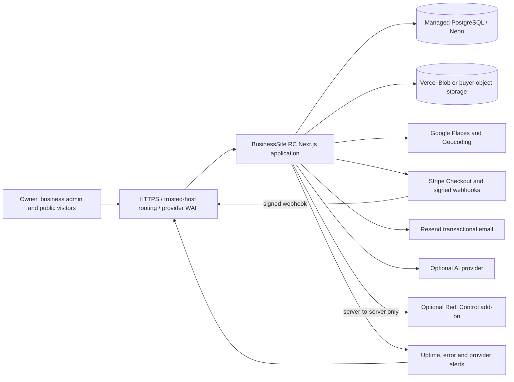

# Deployment topology

The buyer owns every provider account and secret. The source repository never receives production credentials or customer exports.

## Trust boundaries

- Owner routes require the signed platform-owner session and remain under `/owner` and `/api/owner`.
- Business-admin sessions are site-scoped; every mutation resolves the authenticated site on the server.
- Public previews require a signed, revocable token and expire with the trial.
- Stripe webhook state, not the success redirect, activates subscriptions and entitlements.
- Social Media is a separate Stripe add-on. Base website plans never grant `social_media`.
- Redi Control receives only the documented provisioning/session contract. Its integration secret and returned session URL remain server-side.
- Uploaded media uses object storage in production; PostgreSQL binary storage is a local/core fallback.

## Required production controls

Use TLS, database backups/PITR, exact host allowlisting, provider-edge bot protection, restricted API keys, webhook alerts, uptime monitoring and centralized error reporting. See production readiness before launch.
